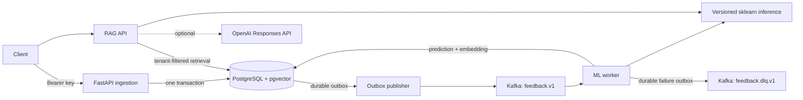

# Customer Feedback AI Platform

A small, working enterprise-style AI backend: authenticated feedback ingestion, durable asynchronous processing, versioned CPU inference, PostgreSQL/pgvector retrieval, and cited insights. No frontend, GPU, paid API, or cloud account is needed for the default demo.

**Measured evidence:** 4,000 load-test events completed with no failures; worker, broker, database, and unhealthy-model recovery experiments passed. A real local Kubernetes deployment exercised three-worker scaling, tenant-isolated processing/search, readiness protection, and rollback. Read the [benchmark report](docs/benchmarks.md) and [Kubernetes evidence](docs/evidence/kubernetes-local.json) for scope and limits.

**Validation:** 34 tests pass. CPU autoscaling was exercised from one to four inference replicas. See the [verification record](docs/verification.md) for tested capabilities and the optional integrations that remain untested.

## Start locally

Requirements: Docker Desktop with Linux containers, Docker Compose v2, and Python 3.12+ (or [uv](https://docs.astral.sh/uv/)). Allow roughly 4 GB of free memory for the whole stack.

```sh
python scripts/setup_env.py
docker compose up --build --detach --wait --wait-timeout 300
uv sync --frozen --extra dev --python 3.12
uv run python scripts/demo.py
```

`setup_env.py` creates random local credentials in ignored `.env`; it never replaces an existing file. All published ports bind to localhost. API keys are stored as SHA-256 digests in PostgreSQL. Keep the generated `.env` to preserve access to the demo tenants and database volumes.

| Component | Local address / command |
|---|---|
| Ingestion API and OpenAPI | http://localhost:8000/docs |
| Retrieval and insights API | http://localhost:8002/docs |
| Grafana | http://localhost:3000 — user `admin`, password `GRAFANA_PASSWORD` in `.env` |
| Prometheus | http://localhost:9090 |
| PostgreSQL | localhost:55432, database `feedback` (override `POSTGRES_PORT` if needed) |
| Inference, Kafka, worker, outbox | Internal Compose network only |

For Swagger's **Authorize** button, use `DEMO_TENANT_A_KEY` or `DEMO_TENANT_B_KEY` from your local `.env`. REST requests use `Authorization: Bearer <key>`. The tenant is derived from the key, never a caller-supplied tenant ID.

## What runs



The shared Python package produces one immutable image; ingestion, publisher, worker, inference, and RAG are independently deployed processes with separate health probes and metrics. `services/` documents each service boundary. [`docs/architecture.md`](docs/architecture.md) explains the write path and failure semantics.

## API examples

```http
POST /v1/feedback
Authorization: Bearer YOUR_TENANT_KEY
Idempotency-Key: mobile-review-001
Content-Type: application/json

{"text":"The mobile application keeps crashing during checkout.","source":"mobile"}
```

The API returns HTTP 202 with a feedback `id` after PostgreSQL commits. Poll `GET /v1/feedback/{id}` until `status` is `completed` or `failed`. Identical bodies with the same tenant and idempotency key return the same ID; changed bodies return 409. A Kafka outage does not invalidate feedback already accepted into the outbox.

| Endpoint | Purpose |
|---|---|
| `POST /v1/feedback` | Validate and durably accept feedback |
| `GET /v1/feedback/{id}` | Status and selected model prediction |
| `GET /v1/feedback?limit=20&offset=0` | Tenant-scoped pagination |
| `GET /v1/feedback/{id}/predictions` | Immutable prediction history by model version |
| `POST /v1/feedback/{id}/reprocess` | Body `{"model_version":"v2"}`; retry or compare versions |
| `GET /v1/insights` | Exact tenant-wide status, sentiment, and topic counts |
| `POST :8002/v1/search` | Body `{"query":"mobile app crashes","limit":5}` |
| `POST :8002/v1/ask` | Body `{"question":"What complaints concern the mobile application?","limit":5}` |

Each API exposes `/health/live`, `/health/ready`, and `/metrics`. The inference service requires `X-Service-Token` for `/predict`, `/embed`, and `/models`; it also implements an optional KServe V2 inference endpoint.

## ML and retrieval

`v1` and `v2` are real scikit-learn TF-IDF + logistic regression classifiers, trained reproducibly from a small committed synthetic corpus. A separate TF-IDF + truncated SVD encoder produces normalized 128-dimensional vectors (`lsa-v1`). This is an inexpensive latent semantic baseline, with limited vocabulary and quality; it is not a pretrained language model. Models and encoder are built once at service startup. No untrusted pickle is loaded.

The 18-example held-out evaluation reports actual accuracy, confusion matrices, model differences, and timings in [`models/evaluation/results.json`](models/evaluation/results.json). It is a smoke evaluation, not proof of production quality. See [`models/README.md`](models/README.md).

By default, `/v1/ask` returns an **extractive** summary with verbatim source excerpts and `[n]` citations. To enable LLM-generated answers, set `LLM_PROVIDER=openai`, `OPENAI_API_KEY`, and your chosen supported `OPENAI_MODEL` in `.env`, then run `docker compose up -d rag`. This sends only the authenticated tenant's retrieved evidence to the configured API. Provider failures or invalid citation references fall back to the local extractive answer. Valid citation numbers do not guarantee factual entailment; the response explicitly says so. No paid LLM calls are required by tests.

## Demonstrate the engineering

```sh
uv run ruff check .
uv run pytest tests/unit -q
uv run pytest tests/integration -m integration -q
uv run python models/evaluation/evaluate.py
uv run python scripts/benchmark.py --help
uv run python scripts/reliability.py --help
```

The live integration suite exercises actual PostgreSQL, Kafka, inference, RAG, idempotency, and tenant isolation. Reliability experiments intentionally stop project services and restore them in `finally` blocks. Run them only against this local demo stack, separately from benchmarks.

Operational recipes:

```sh
docker compose up -d --scale worker=3
docker compose logs -f worker outbox
docker compose stop
docker compose start
```

Kafka has six partitions, so up to six worker replicas can actively consume this topic. The database uniqueness constraints remain the authority for duplicate prevention. `docker compose down` preserves volumes; adding `--volumes` destroys local data.

Model comparison uses the `reprocess` endpoint with `v2`, then `v1` to restore the earlier selected prediction while retaining both results. Set `MODEL_VERSION=v2` and recreate ingestion/inference to pin newly ingested events to v2. Existing events retain their original version. Kubernetes deployments support rollout status, history, rollback, resource requests, and optional HPA; see [`docs/kubernetes.md`](docs/kubernetes.md).

## Repository and evidence

- [`docs/design-decisions.md`](docs/design-decisions.md): Kafka tradeoffs, synchronous inference, idempotency, tenancy, model rollouts.
- [`docs/benchmarks.md`](docs/benchmarks.md): measured throughput, percentile latencies, CPU/memory samples, charts, and limitations.
- [`docs/incident-runbook.md`](docs/incident-runbook.md): Kafka, database, worker, model, and DLQ recovery.
- [`infrastructure/kubernetes/`](infrastructure/kubernetes/): development cluster manifests and optional autoscaling/KServe.
- [`monitoring/`](monitoring/): provisioned Grafana dashboard and Prometheus alerts.
- [`.github/workflows/ci.yml`](.github/workflows/ci.yml): lint, tests against the real Compose stack, Kubernetes schema validation, and GHCR image publication after passing checks.

The cluster manifests are a reproducible **development** deployment, not a highly available cloud installation. Cloud provisioning is intentionally omitted: no paid infrastructure is created. Before external production use, add TLS, Kafka authentication/ACLs, a managed secrets system, per-service database roles, backups, retention/deletion policy, ingress rate limiting, larger representative model evaluation, and capacity planning. See the explicit trust boundaries in the architecture document.
