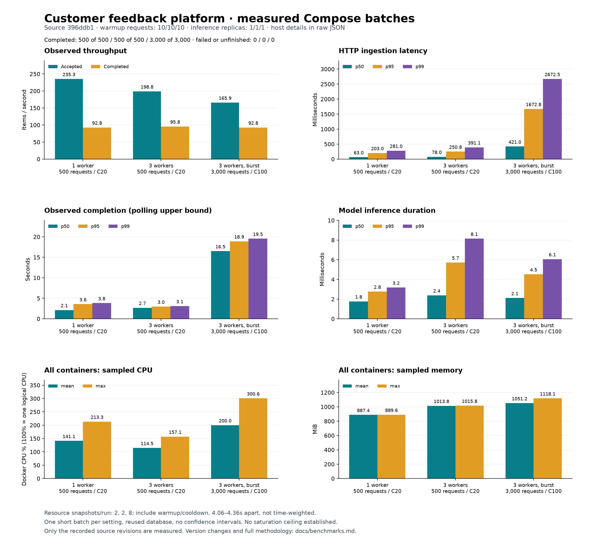

# Measured performance and reliability

All 4,000 measured feedback items were accepted and completed, with no HTTP failures,
processing failures, or timeouts. These are real local Compose runs from source commit
[`396ddb1`](https://github.com/etonealbert/customer-feedback-ai-platform/commit/396ddb16b9d565242b81489aaaf34b17f4871b0b),
recorded with clean working trees on **November 14, 2026, 21:58–22:00 Argentina time**
(November 15, 00:58–01:00 UTC). Subsequent worker retry, shutdown, and lag-metric hardening
has **not** been rebenchmarked in these files. The evidence establishes observed batch
behavior; it does not establish a sustained saturation ceiling or production capacity.



[Scalable SVG](evidence/benchmark-comparison.svg) ·
[1-worker raw JSON](evidence/load-1worker.json) ·
[3-worker raw JSON](evidence/load-3workers.json) ·
[3-worker burst raw JSON](evidence/load-burst-3workers.json)

## Workload and throughput

The host ran Windows 11, Python 3.12.13 and Docker Desktop Linux containers. The load
client reported 24 logical CPUs; container memory limits reported 15.31 GiB. Each run
used ten excluded warmup requests, one inference replica, one PostgreSQL instance,
one Kafka broker, and the same eight short synthetic feedback texts. The database was
retained between runs, so later runs had more rows and warmer caches. The local kind
cluster was started **after** these measurements.

| Run | Measured items | Concurrency | Ingestion window | Full window | Accepted/s | Completed/s | HTTP / processing / timeout errors |
| --- | ---: | ---: | ---: | ---: | ---: | ---: | --- |
| 1 worker | 500 | 20 | 2.125 s | 5.390 s | 235.29 | 92.76 | 0 / 0 / 0 |
| 3 workers | 500 | 20 | 2.515 s | 5.218 s | 198.81 | 95.82 | 0 / 0 / 0 |
| 3 workers, burst | 3,000 | 100 | 18.078 s | 32.344 s | 165.95 | 92.75 | 0 / 0 / 0 |

Accepted throughput is HTTP 202 responses divided by the ingestion window. Completed
throughput divides completed items by the full ingestion-plus-polling window. It is
therefore an observed client rate, not an isolated Kafka-consumer service-rate measurement.
All three observed failure rates were 0%; short successful runs do not bound the true
long-run failure probability.

## Latency and inference timing

All values below are **milliseconds**. Percentiles use linear interpolation over retained
observations. Each row has 500, 500, or 3,000 successful samples, respectively.

| Run | Measurement | p50 | p95 | p99 | Mean | Maximum |
| --- | --- | ---: | ---: | ---: | ---: | ---: |
| 1 worker | HTTP ingestion | 63.00 | 203.00 | 281.01 | 81.39 | 391.00 |
| 1 worker | Completion observed by client | 2,141.00 | 3,578.05 | 3,828.00 | 2,494.93 | 4,015.00 |
| 1 worker | Model inference | 1.7676 | 2.7665 | 3.1721 | 1.8796 | 3.9798 |
| 3 workers | HTTP ingestion | 78.00 | 250.75 | 391.15 | 96.31 | 485.00 |
| 3 workers | Completion observed by client | 2,688.00 | 2,985.00 | 3,110.15 | 2,707.28 | 3,219.00 |
| 3 workers | Model inference | 2.3845 | 5.7237 | 8.1415 | 2.7918 | 9.5266 |
| 3 workers, burst | HTTP ingestion | 421.00 | 1,672.75 | 2,672.46 | 586.73 | 4,500.00 |
| 3 workers, burst | Completion observed by client | 16,500.00 | 18,890.00 | 19,547.16 | 16,601.46 | 22,953.00 |
| 3 workers, burst | Model inference | 2.1129 | 4.5316 | 6.0587 | 2.4272 | 60.4973 |

HTTP latency starts after acquiring the client concurrency slot. Completion latency
starts at send time and ends at the first poll that sees `completed`. Polling begins
**after all submissions finish**, so early items may have completed substantially before
they are observed; these completion latencies are upper bounds, especially for the burst.
Inference timing is measured inside the inference service, excluding Kafka wait, HTTP
transport and database work.

## Observed CPU and memory

Docker statistics were collected alongside the load, including warmup and brief cooldown.
There were only **2, 2, and 8 snapshots**, at actual intervals of **4.063–4.359 seconds**:
the collector sleeps two seconds *after* each `docker stats --no-stream` call completes.
The values below are arithmetic sample means and observed maxima, not time-weighted
means or guaranteed peaks. CPU uses Docker's convention, where 100% is one logical CPU
and multicore workloads may exceed 100%. Memory is used memory converted to MiB.

The all-container values sum each simultaneous snapshot, including Prometheus, Grafana
and the mostly idle RAG service; they do not sum independent per-service maxima.

| Run | Snapshots | Total CPU mean | Total CPU maximum | Total memory mean | Total memory maximum | Worker memory mean / maximum |
| --- | ---: | ---: | ---: | ---: | ---: | ---: |
| 1 worker | 2 | 141.11% | 213.29% | 887.36 MiB | 889.63 MiB | 52.69 / 52.69 MiB |
| 3 workers | 2 | 114.53% | 157.06% | 1,013.80 MiB | 1,015.84 MiB | 162.13 / 162.51 MiB |
| 3 workers, burst | 8 | 199.96% | 300.63% | 1,051.25 MiB | 1,118.13 MiB | 164.47 / 182.73 MiB |

For the longer burst, the per-service samples were:

| Component | CPU mean | CPU maximum | Memory mean | Memory maximum | Samples |
| --- | ---: | ---: | ---: | ---: | ---: |
| Ingestion | 40.30% | 48.07% | 51.74 MiB | 59.47 MiB | 8 |
| Inference | 35.88% | 63.49% | 110.26 MiB | 110.40 MiB | 8 |
| Workers, summed across 3 replicas | 46.05% | 99.48% | 164.47 MiB | 182.73 MiB | 8 |
| Outbox | 6.60% | 15.82% | 52.28 MiB | 60.40 MiB | 8 |
| PostgreSQL | 25.52% | 42.31% | 71.85 MiB | 74.46 MiB | 8 |
| Kafka | 44.86% | 161.89% | 427.77 MiB | 497.50 MiB | 8 |
| RAG | 0.14% | 0.29% | 53.19 MiB | 53.20 MiB | 8 |
| Prometheus | 0.39% | 0.82% | 43.96 MiB | 44.53 MiB | 8 |
| Grafana | 0.21% | 0.49% | 75.72 MiB | 75.72 MiB | 8 |

Raw JSON retains each container observation. `python scripts/render_evidence.py` derives
these statistics and regenerates the comparison PNG and SVG with Matplotlib.

## What the comparison supports

Scaling from one to three workers at 500 items/concurrency 20 changed observed completed
throughput from 92.76/s to 95.82/s, a **3.30% increase**. Completion p95 fell **16.57%**
and p99 fell **18.75%**, but p50 rose **25.55%**. HTTP ingestion throughput fell **15.51%**,
and ingestion p99 rose **39.19%**. Worker memory rose from about 53 MiB to 162 MiB.
This single pair does not establish a reliable scaling improvement; there are no repeated
trials, confidence intervals, or controlled cache resets.

The burst raised ingestion p95 to 1.67 seconds while model inference p95 remained
4.53 milliseconds. The gap suggests that queueing, transport and database coordination
deserve profiling. It does **not** identify one proven bottleneck: sampled inference CPU
peaked at 63.49%, PostgreSQL at 42.31%, and outbox at 15.82%; none demonstrates sustained
CPU saturation. Kafka had a 161.89% sampled spike but only 44.86% mean CPU. A short spike
does not establish Kafka as the limit. The small throughput gain from extra workers also
does not justify increasing replicas indefinitely.

The next defensible experiment is a repeated, longer rate sweep with overlapping
completion observation and Prometheus lag measurements. Profile outbox transaction time,
worker HTTP/database round trips and inference scheduling, then change one factor at a
time. Batch publishing or database work, separate connection-pool tuning, and inference
replicas are candidate changes to test. **No performance improvement from those changes
is claimed or fabricated here.** These measurements did not locate a sustained saturation
ceiling, and no production capacity figure is asserted.

## Reliability observations

[Raw reliability evidence](evidence/reliability-local.json) contains the commands, timestamps,
accepted feedback IDs and SQL audits from five successful Compose experiments. Durations
below cover the complete experiment, including command startup and probes; they are not
isolated recovery-time objectives.

| Experiment | Duration | Observed behavior |
| --- | ---: | --- |
| Worker SIGKILL and restart | 18.890 s | 60 pending items before and immediately after the kill; all 60 later completed, with 60 predictions and no duplicate `(feedback_id, model_version)` keys. |
| Kafka unavailable and restarted | 9.266 s | 60 submissions accepted while Kafka was stopped; all 60 completed after restart, with no duplicate predictions. |
| PostgreSQL unavailable and restarted | 16.984 s | Ingestion and readiness both returned 503 during the outage; 3 new items completed after recovery. |
| Invalid model deployment and rollback | 26.485 s | `definitely-invalid` failed the inference readiness probe; 3 pending items completed after restoring the deployment and restarting paused workers. |
| v1 → v2 → v1 model rollback | 0.922 s | One feedback item retained two immutable versioned predictions and returned to v1; no duplicate version keys. |

A subsequent [25-second Kafka outage](evidence/reliability-long-kafka-outage.json) also
passed after the shutdown/retry hardening: 60 feedback items were accepted during the
outage, all 60 completed after restart, and the SQL audit found 60 predictions with zero
duplicate version keys. This is an additional reliability observation, not a performance
rerun of the earlier source commit.

The SIGKILL timing did not prove a crash between database commit and offset commit;
explicit Kafka-redelivery tests separately cover duplicate handling. The invalid-model
experiment used Compose replacement with workers deliberately paused, so it makes no
claim about Kubernetes rolling-update availability. See the
[incident runbook](incident-runbook.md) and [Kubernetes operations](kubernetes.md) for their
respective procedures and evidence.

## Reproduce

With the Compose stack healthy and the development environment installed:

```sh
docker compose up -d --scale worker=1
python scripts/benchmark.py --count 500 --concurrency 20 --warmup 10 --output docs/evidence/new-1worker
docker compose up -d --scale worker=3
python scripts/benchmark.py --count 500 --concurrency 20 --warmup 10 --output docs/evidence/new-3workers
python scripts/benchmark.py --count 3000 --concurrency 100 --warmup 10 --output docs/evidence/new-burst
python scripts/reliability.py --output docs/evidence/new-reliability.json
docker compose up -d --scale worker=1
python scripts/render_evidence.py
```

The final command renders the three committed `load-*.json` baselines by default. To
render a new comparison, copy your chosen runs into a separate evidence directory under
the corresponding names and pass `--evidence-dir DIRECTORY --output-prefix OUTPUT`.
Do not overwrite the historical baseline merely because a newer result differs. Record
the new commit, workload, host and any concurrent activity, and preserve failures too.
